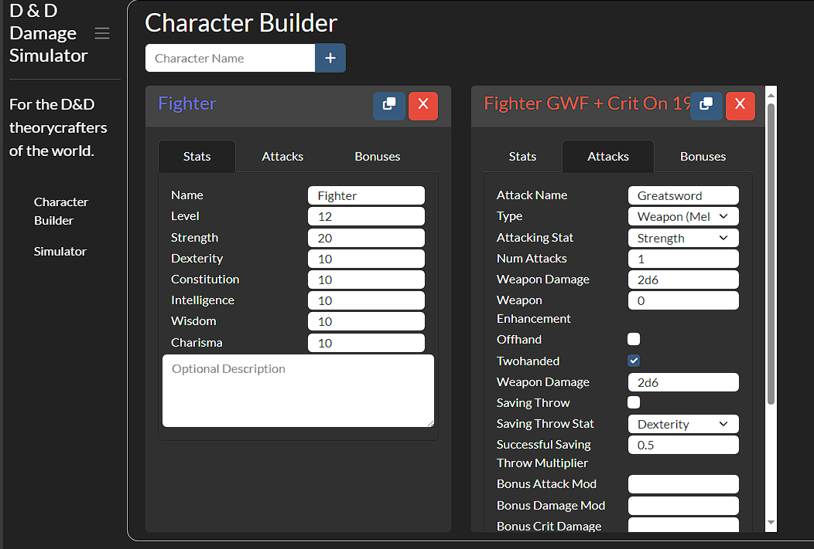
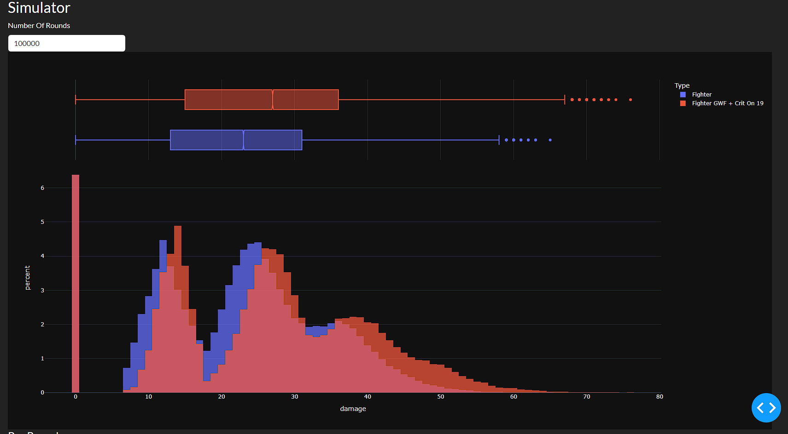

# Dungeons and Dragons Damage Simulator

Live here: https://d-and-d-damage-simulator-745953dd5908.herokuapp.com/

##  For the D and D Theory Craftors of the World

* Simulates many thousand turns of combat to find distributions of damage for a given character
* Compare D&D characters at once for the theory crafters of the world, i.e.:
    * A Barbarian with Reckless Attacks with Advantage
    * A Fighter With the two Great Weapon Master Feat
* Not sure which Feat to take for optimal DPS? Well why not simulate them all and find out?

## References/Motivation ##
* https://www.youtube.com/@DnDDeepDive
* https://www.reddit.com/r/BG3Builds/comments/157p0cl/the_math_of_critical_hits_in_dd_5e_is_critfishing/?onetap_auto=true
* https://statmodeling.stat.columbia.edu/2014/07/12/dnd-5e-advantage-disadvantage-probability/
* https://forums.giantitp.com/showthread.php?582779-Comprehensive-DPR-Calculator-%28v2-0%29
* https://anydice.com/program/22f8c

## How to Install and Run Locally
* Download or git clone the repo from: https://github.com/AClaybrook/DAndDSimulator
* Install [uv](https://docs.astral.sh/uv/getting-started/installation/) (it installs the right Python version for you)
* `uv sync` to create the virtual environment and install the dependencies
* Launch the App on localhost 8050:
    * `uv run python app.py`
    * Or select the `.venv` interpreter and run app.py from VsCode
* Development:
    * `uv run pytest` to run the tests (the simulation is validated against exact analytic results)
    * `uv run ruff check .` to lint
    * `uv run python -m benchmarks.benchmark` to time the simulation, run it before and after changing `computations/`

See [CHANGELOG.md](CHANGELOG.md) for what changed in 2.0.

# Technical Notes/Features:

## Project Layout
* `computations/`: the generic simulator
    * `models.py`: Character, Enemy and Attack dataclasses, and the translation of class features into attack/damage contexts
    * `numerical_simulation.py`: vectorized numpy simulation
    * `analytic.py`: exact expected damage, used for tests and the Attack Breakdown tables
* `game_data/`: the optional game database, everything it produces is a plain Character/Enemy/Attack that can still be edited
    * `weapons.json`, `spells.json`, `monsters.json`: SRD weapons, spells, and monster defenses
    * `classes.py`: prebuilt characters that level up (attacks, feats/ASIs, subclass features, cantrip scaling, spell slots) for the BG3 and 5e rulesets
* `components/`: Dash layout and callbacks
* `tests/`, `benchmarks/`

## Completed Features:
* UI: Character, Enemy, Simulator, and Tables
* Collapsable nav/sidebar
* Import and Export of characters via json
* Simulate Combat from UI values
* 5 simulation types and corresponding plots:
    * Damage Per Round
    * Damage Per Attack
    * Damage Per Round/Attack sweeps over a parameter:
        * Armor Class, with insights on when to turn GWM/Sharpshooter off
        * Level, preset characters level up realistically and keep your edits
        * Enemy Save Bonus
        * Attack Ability Score
    * Rounds to Kill (uses enemy hit points)
* Export Damage Results to csv
* Implement easy callbacks in javascript
* Reduce memory of dataframes
* Random Seed toggle for random vs repeatable results
* Character presets that level up realistically, with a BG3 or 5e ruleset
* Weapon and spell templates for attacks
* Monster presets and CR baselines, damage type resistances/vulnerabilities/immunities, per ability saving throws
* Once per turn damage (sneak attack, smite), per attack eligibility and crit only (crit fishing)
* Leaderboard and exact per attack breakdown
* Validated numerical sims with tests

## Roadmap
Rough priority order, the first items have the most impact for the least work.

### Done in 2.1
* DPR vs Level sweep with realistic preset level ups, sweep leaderboards
* GWM/Sharpshooter breakeven insights
* Per attack once per turn eligibility, crit fishing smites
* Battle Master, BG3 Thief and crit fishing Paladin builds

### Done in 2.2
* Sweep parameter dropdown with Enemy Save Bonus and Attack Ability Score sweeps
* Level sweeps keep manual edits to preset characters
* Two Weapon Fighting Champion and Hexblade Warlock builds

### Next
* Multiclass presets (i.e. Paladin/Warlock, Fighter/Rogue), which need per-class level splits for features and spell slots
* First round effects: Gloom Stalker's Dread Ambusher, Assassinate, and other once per fight bonuses (needs a per-encounter view rather than per-round averages)
* Resource limited presets: smites, superiority dice and Hexblade's Curse per short/long rest (see Later)
* BG3 specific mechanics: weapon actions, Elemental Adept, Savage Attacker per BG3 patch rules, BG3 item database (i.e. +1d4 rings, Gloves of the Belligerent Skald), verified against the game

### Later
* Resources per short/long rest: number of encounters and rounds per encounter, so spell slots, rage, ki and smites are limited rather than unlimited
* Conditional damage: GWM bonus attack on a crit/kill, Colossus Slayer only on damaged targets, Toll the Dead d12 vs damaged targets
* Multiple enemies and area of effect spells
* Party mode: buffs between characters (Bless, Haste, Faerie Fire) and turn order
* Saving/uploading enemies, editable monster database from the UI
* Extract "insights", i.e. when to turn on/off GWM/Sharpshooter (the AC where it stops paying off)
* Damage Source diffs, i.e. the damage gained from Bless
* Variable Color Theme
* Better app logging

### Backlog
* Ability checks
* Status effects: stunned, restrained, prone
* Enemies fighting back (hit points/AC of the character mattering)

## Current Assumptions/Limitations ##
* Calculations follow the BG3 ruleset by default. Presets and attack templates can use the 5e ruleset instead, which mostly changes the level cap and cantrip/extra attack progression
* Classes and Races are not fully implemented, just the main damaging perks
* Assume resources are unlimited (i.e. not tracking spell slots)
* No multitarget, single target only
* Enemys do not fight back/ not considering back and forth combat. So a character with 10 hp and 10 ac is just as good at damage as a character with 100 hp and 20 ac. Only enemy defensive stats matter
* Do not consider turn order/initive
* 1 character at a time, no party mode
* 1 Enemy at a time
* Focused on damage, therefore actions that do not involve damage as not implemented
* Validation of build feasability is not done. Garbage in/ garbage out
    * Only some basic checks like GWM only with twohanded weapons 
* Adjusting rolls needed for critial hits (Crit on) needs to be applied manually, i.e. a Fighter taking the Champion subclass, spell sniper feat need to be accounted for by manually reducing the Character Crit on field (the Champion presets do this for you)
* Bonus damage dice use the attack's damage type for resistances, i.e. Hex on an Eldritch Blast is treated as force damage
* Once per turn damage applies to the first hit (or crit, if crit only) of any eligible attack roll (not saving throw spells)
* Rounds to kill resamples simulated rounds, since rounds are independent of each other
* no status effects, stunned, restrained etc

### Callback Implementation Quirks:
* Copy callback and others get called unintentionally when a character is deleted, because the Inputs techically change
    * Solution is to check the time of the clicked button (n_clicks_timestamp) against the last handled click, stored in `last-card-click`
    * dbc.Button no longer has n_clicks_timestamp, so the card buttons are html.Button with bootstrap classes
* Can not use MATCH for an Inuput when an Output doesn't have a MATCH, thus have to reach in ALL Inputs

### Build ideas
* Bladesinger
* Ice Sorcerer, prone
* Fire sorceror
* Gloomstalker, assasin
* Wardomain cleric, 
* Life domain cleric, healing extreme
* Barbarian cleave (bleed build)
* Bard crossbow arcane acuity
* Pure Fighter

