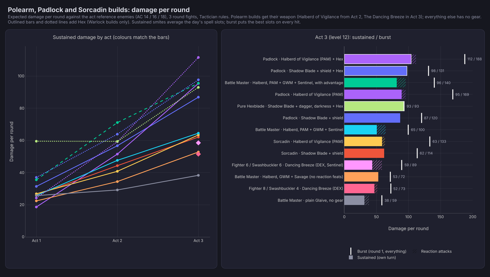
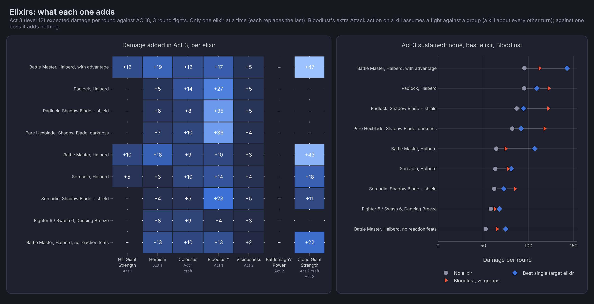
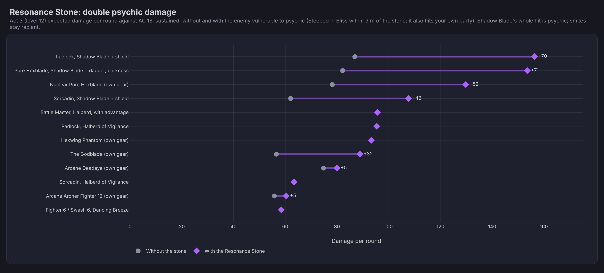

# Padlock vs Sorcadin vs polearm builds (Tactician)

Expected damage per round against the act reference enemies (AC 14 / 16 / 18), as **sustained / burst**. These are the planner example
builds of the same names. Only the polearm builds get gear (their weapon), so the class and weapon choices are what differ. Generated with
the engine (bg3/character.py, computations/analytic.py).

> **After the rules fixes of 2026-11-10** (Savage Attacker and Great Weapon Fighting on rider dice, Lifedrinker as necrotic damage, the
> pact weapon's Charisma only in the main hand) the sustained numbers below move by 3 at most: the Halberd of Vigilance builds gain 1 to 3
> in Acts 2 and 3 (Padlock 95 to 98, Sorcadin 63 to 65, Battle Master 64 to 66 and 53 to 56), the others are unchanged. With the
> Resonance Stone the pure Hexblade is 144, not 154. The tables and charts keep the earlier figures except where noted. Haste is now
> a whole extra Attack action outside Honour Mode, which none of these tables use.

## How the numbers are counted

- **Sustained:** the average round of a 3 round fight with the day's resources spread over 4 fights (2 short rests). A smite is used at
  most once per turn, and its size is the **average of the day's slots** (2d8 from a level 1 slot, +1d8 a level, at most 5d8): the
  Padlock's pact slots come back on short rests, the Sorcadin's sorcery points become one more slot (Flexible Casting), and the slot
  Shadow Blade was cast with is gone. In Act 3 that is 3.25 smites a fight averaging 3.2d8 for the Padlock, 3.5 averaging 3.4d8 for
  the Sorcadin.
- **Burst:** round 1 with everything: a smite on **every** weapon hit (reactions included) with the best slots first, Action Surge, and
  for the Sorcadin a Quickened Fireball as the bonus action (single target, DEX save, +CHA for a red Draconic Sorcerer). No party buffs.
- **Shadow Blade** is cast with the best slot: 3d8 for the Padlock (a level 3 pact slot), 4d8 for the Sorcadin (a level 5 slot). It lasts
  until a long rest and needs no concentration. Its own advantage (dim light or darkness) isn't counted separately, because every
  Vengeance Paladin here already attacks with advantage from Vow of Enmity.
- **Feats by Act 3:** Padlock and Sorcadin get 2 (Shadow Blade builds: +3 to their attack ability, Halberd builds: +2 and Polearm Master),
  the Battle Master 4 (Polearm Master, GWM, +2 Strength, Sentinel). Great Weapon Master is used or not, whichever is higher.
- **Why the Padlock hits harder than the Sorcadin:** per hit 3d8 + 11 (Charisma 5 from the pact weapon, Duelling 2, Hexblade's Curse 4)
  with crits on 19-20, three times a turn, against the Sorcadin's 4d8 + 7, twice a turn. The Sorcadin's bigger slots only show in burst.

| Build | Act 1 (lv 5) | Act 2 (lv 8) | Act 3 (lv 12) | One reaction attack, Act 3 |
|---|---|---|---|---|
| Padlock: Shadow Blade + shield | 31 / 31 | 57 / 80 | 87 / 120 | 23 |
| Padlock: Greatsword (GWF, GWM) | 21 / 21 | 45 / 66 | 65 / 93 | 15 |
| Padlock: Glaive (GWF, Polearm Master) | 19 / 19 | 41 / 62 | 72 / 135 | 13 |
| Sorcadin: Shadow Blade + shield | 26 / 43 | 44 / 65 | 62 / 114 | 23 |
| Sorcadin: Greatsword (GWF, GWM) | 31 / 51 | 34 / 56 | 41 / 87 | 12 |
| Sorcadin: Glaive (GWF, Polearm Master) | 27 / 47 | 31 / 52 | 47 / 113 | 9 |
| Battle Master: Glaive (Polearm Master, GWM, Sentinel) | 26 / 36 | 29 / 42 | 38 / 58 | 11 |
| Battle Master: Halberd of Vigilance (Polearm Master, GWM, Sentinel) | 26 / 36 | 48 / 71 | 64 / 100 | 17 |
| Battle Master: Halberd of Vigilance (GWM, Savage Attacker, no reaction feats) | 22 / 30 | 34 / 46 | 53 / 72 | 13 |
| Padlock: Halberd of Vigilance (GWF, Polearm Master) | 19 / 19 | 52 / 75 | 95 / 169 | 18 |
| Sorcadin: Halberd of Vigilance (GWF, Polearm Master) | 27 / 47 | 41 / 65 | 63 / 133 | 14 |
| Fighter 8 / Swashbuckler 4: The Dancing Breeze (Dexterity, Polearm Master) | 9 / 12 | 8 / 10 | 52 / 72 | 11 |
| Fighter 9 / Swashbuckler 3: Glaive (Polearm Master, GWM) | 26 / 36 | 22 / 31 | 25 / 36 | 6 |
| Padlock: Shadow Blade + shield (Honour Mode) | 31 / 31 | 57 / 80 | 63 / 83 | 23 |

## Takeaways

- **Pact of the Blade's Extra Attack stacks with the Paladin's outside Honour Mode** (bg3.wiki, Deepened Pact). That third attack at
  Warlock 5 + Paladin 5 is the Padlock's edge: in Honour Mode the same build drops from 87 to 63 sustained in Act 3.
- **Act 3: the Padlock beats the Sorcadin on sustained (87 vs 62) and burst (120 vs 114)** with Shadow Blade and a shield. Without Vow of
  Enmity's advantage the Padlock still leads sustained (64 vs 46), and the Sorcadin edges burst (87 vs 83). The Sorcadin also has
  Fireball for groups, which a single target number doesn't show.
- **Shadow Blade + shield is the best non-gear weapon for both** (Shadow Blade's d8s, Duelling's +2, and smites land more often without
  GWM's -5), plus +2 AC. With the Halberd of Vigilance the polearm builds pass it.

## Polearm builds and the Halberd of Vigilance

| Act 3 | Own turn | Reactions | Sustained / burst |
|---|---|---|---|
| Battle Master, Halberd, PAM + GWM + Sentinel, with advantage | 82 | +14 | 96 / 140 |
| Padlock, Halberd of Vigilance (PAM) | 89 | +6 | 95 / 169 |
| Padlock, Shadow Blade + shield | 87 | +0 | 87 / 120 |
| Battle Master, Halberd, PAM + GWM + Sentinel | 51 | +14 | 64 / 100 |
| Sorcadin, Halberd of Vigilance (PAM) | 59 | +5 | 63 / 133 |
| Sorcadin, Shadow Blade + shield | 62 | +0 | 62 / 114 |
| Battle Master, Halberd, GWM + Savage (no reaction feats) | 53 | +0 | 53 / 72 |
| Fighter 8 / Swashbuckler 4, Dancing Breeze (DEX) | 47 | +4 | 50 / 60 |
| Battle Master, plain Glaive, no gear | 31 | +7 | 38 / 58 |

- **The plain Glaive with no gear** hits AC 18 55% of the time for 1d10 + 4: no magic weapon, no smites, no advantage, and GWM's -5 isn't
  worth it there. It is a no gear baseline, not how the build is played.
- **The Halberd of Vigilance** (Act 2) roughly doubles it: +2 to hit and damage, 1d4 force on every hit, and every reaction attack with
  advantage. With Polearm Master (an enemy entering your reach, about once a fight) and Sentinel (an enemy next to you attacking an ally,
  about every other round) the reactions add about 14 a round in Act 3, so the reaction feats beat Savage Attacker and Strength (65 vs 53).
  With advantage (Trip Attack's prone, Faerie Fire) the Battle Master reaches 96, level with the Halberd Padlock.
- **On a Padlock** the Halberd is the strongest polearm: a bound pact weapon with 3 attacks and the butt end, smites on every hit in
  burst (169). **On a Sorcadin** it gives a big burst (133) but only 63 sustained: 2 attacks, and no Hexblade's Curse.
- **Dexterity glaive:** only works from Act 3 (The Dancing Breeze is the one finesse polearm), see below.
- Reaction attacks are an estimate (the `reactions` toggle on every build); real fights give more when enemies run past you.

## The Dancing Breeze and Hex

| Act 3, sustained / burst | |
|---|---|
| Padlock, Halberd of Vigilance (Polearm Master) + Hex | 112 / 188 |
| Padlock, Shadow Blade + shield + Hex | 98 / 131 |
| Pure Hexblade 12, Shadow Blade + dagger, darkness advantage + Hex | 93 / 93 |
| Fighter 6 / Swashbuckler 6, The Dancing Breeze (Dexterity, Polearm Master, Sentinel) | 59 / 89 (74 with advantage) |
| Fighter 8 / Swashbuckler 4, The Dancing Breeze (Dexterity, Polearm Master, GWM) | 52 / 73 (77 with advantage) |

- **The Dancing Breeze** is a +2 finesse glaive with Whirlwind Attack (hits every enemy around you). Its point is a Dexterity Rogue with
  reach: Sneak Attack is once per *turn*, so with Polearm Master and Sentinel each reaction attack on an enemy's turn adds another Sneak
  Attack (about 15 a round here), and Whirlwind is area damage this single target number doesn't show. As a single target damage
  dealer it is a mid build; it makes sense as the end of a Dexterity Rogue or Fighter you have played all game, not as a target to
  rebuild for in Act 3.
- **Hex** (+1d6 necrotic per hit, concentration, Warlock spell) stacks with Hexblade's Curse, smites and Shadow Blade, which needs no
  concentration in BG3. It adds about 10 to 16 a round to the Padlocks (more hits, more Hex dice) and puts the pure Hexblade with
  darkness advantage at 93, level with the Halberd Padlock without Hex. Builds with no Warlock level don't get it.

## Elixirs

Sustained damage with no elixir → with the best elixir you can have by then (one at a time: every elixir replaces the one before):

| Build | Act 1 | Act 2 | Act 3 | Act 3 with Bloodlust (groups) |
|---|---|---|---|---|
| Padlock, Shadow Blade + shield | 31 → 36 (Heroism) | 57 → 62 (Colossus) | 87 → 95 (Colossus) | 122 |
| Padlock, Halberd of Vigilance (PAM) | 19 → 23 (Colossus) | 52 → 58 (Colossus) | 95 → 109 (Colossus) | 123 |
| Sorcadin, Shadow Blade + shield | 26 → 31 (Colossus) | 44 → 57 (Cloud Giant Strength) | 62 → 73 (Cloud Giant Strength) | 85 |
| Sorcadin, Halberd of Vigilance (PAM) | 27 → 33 (Colossus) | 41 → 51 (Cloud Giant Strength) | 63 → 81 (Cloud Giant Strength) | 77 |
| Battle Master, Halberd, PAM + GWM + Sentinel, with advantage | 36 → 47 (Colossus) | 71 → 102 (Cloud Giant Strength) | 96 → 143 (Cloud Giant Strength) | 112 |
| Battle Master, Halberd, PAM + GWM + Sentinel | 26 → 35 (Hill Giant Strength) | 48 → 77 (Cloud Giant Strength) | 64 → 107 (Cloud Giant Strength) | 75 |
| Battle Master, Halberd, GWM + Savage (no reaction feats) | 22 → 30 (Hill Giant Strength) | 34 → 55 (Cloud Giant Strength) | 53 → 75 (Cloud Giant Strength) | 65 |
| Fighter 6 / Swashbuckler 6, Dancing Breeze (DEX, Sentinel) | – | – | 58 → 68 (Colossus) | 63 |
| Pure Hexblade, Shadow Blade + dagger, darkness | 48 → 56 (Colossus) | 48 → 56 (Colossus) | 82 → 92 (Colossus) | 118 |

| Elixir | Effect | When you can have it |
|---|---|---|
| Hill Giant Strength | Strength 21 | Act 1: Auntie Ethel sells 3 a long rest (Grove, then the Riverside Teahouse), Derryth (Myconid Colony); craftable |
| Heroism | +1d4 to attacks and saves (stacks with Bless), 10 temp HP | Act 1: Mol (Tiefling Hideout), Talli; craftable |
| Colossus | +1d4 weapon damage | Act 1, craftable only from Chasm Creepers along the Underdark paths, so a handful |
| Bloodlust | An extra action, once a turn, when you kill | Act 1: Cyrel, Derryth, Kith; craftable from Worg Fangs |
| Viciousness | Crit range +1 | Trader stock from level 6 (Act 2); craftable |
| Battlemage's Power | +3 spell attacks and save DC (3 Arcane Acuity) | Trader stock from level 6 (Act 2); craftable |
| Cloud Giant Strength | Strength 27 | Trader stock from level 9 (Act 3); craftable from Cloud Giant Fingers sold in the Myconid Colony from level 6, so a few in Act 2 |

- **Strength builds: Cloud Giant Strength is the biggest single upgrade in the game** (+43 to +47 on the Halberd Battle Master in Act 3,
  Strength 19 → 27). Before you can make it, Hill Giant (+10) or Heroism (+18) are the picks; Heroism is best when GWM's -5 is hurting.
- **Charisma builds (Padlock, pure Hexblade) gain nothing from the Strength elixirs.** Their best single target elixir is Colossus
  (+8 to +14, more attacks, more 1d4s) or Heroism; Viciousness adds about 5.
- **Bloodlust** is the biggest gain for builds with many attacks per action (+27 to +36 for the Padlocks and pure Hexblade) but only
  against groups: the extra Attack action needs a kill on your turn (estimated every other turn here), so against a single boss it adds
  nothing. In Honour Mode the extra action doesn't get Extra Attack.
- **Battlemage's Power** does nothing for weapon attacks (Shadow Blade and smites aren't spell attacks); it only adds a little to the
  Sorcadin's Quickened Fireball (+3 DC).

## Arcane Archers and the Hexwing

| Act 3, single target, sustained | No gear | Its own gear | + Humanoid Slaying arrow a round | + Smokepowder arrow a round |
|---|---|---|---|---|
| Arcane Archer Fighter 12 (Sharpshooter, Archery) | 37 | 56 | 64 | 74 |
| 5. Arcane Deadeye (Arcane Archer 11 / War Cleric 1; Gontr Mael in Act 3) | 34 | 75 | 85 | 96 |
| 3. Hexwing Phantom (Swashbuckler 4 / Hexblade 5 / Swarmkeeper 3; The Dancing Breeze in Act 3) | | 93 | | |
| For scale: Padlock, Shadow Blade + shield (no gear) | 87 | | | |

- **Arcane Shots** are counted: 4 / 7 / 10 Arcane Arrows a short rest at Fighter 3 / 7 / 10 (bg3.wiki), one per round on the first
  attack (Beguiling Arrow, +2d6 psychic) until they run out, which they rarely do in a 3 round fight.
- **Special arrows** (consumables, one a round on the first attack): elemental arrows (Fire, Ice, Lightning, Acid, from Act 1) add 2d4
  that a Dexterity save negates, about +1 to +2 a round. Slaying arrows (trader level 6) double the weapon's base damage against one
  creature type, Sharpshooter's +10 included: Humanoid Slaying adds about +7 to +10 a round against humanoids. Smokepowder Arrows (trader
  level 9) add 4d6 fire + 4d6 force, about +15 to +20 a round. They cost gold and run out; elemental arrows are plentiful.
- **Where archers stand:** without gear a Fighter archer is level with the no gear Battle Master (no smites, no advantage, Sharpshooter's
  -5 against AC 18). With their gear and a slaying or Smokepowder arrow every round they reach the Padlock's range (75 to 96). Not
  counted here: safety at range, high ground (+2 to hit), and the control and area Arcane Shots (Bursting, Banishing, Piercing).
- **Hexwing at level 8:** with the doc's order (Swashbuckler 4 first) it is Rogue 4 / Hexblade 4: one attack, plus Flick o' the Wrist as the
  bonus action. Taking Hexblade 5 first gives two attacks (Deepened Pact) but no Flick yet: about the same damage at level 8. It never gets
  a third attack (no Paladin, Fighter or Ranger 5). Its weapon is bound with Bind Hexed Weapon, so it attacks with **Charisma** (bg3.wiki:
  even if Strength or Dexterity is higher). In Act 3 The Dancing Breeze (finesse) turns Sneak Attack back on, and with its gear and
  Swarmkeeper's die it reaches 93.

## The Resonance Stone

The Resonance Stone (Mind Flayer Colony, end of Act 2; bg3.wiki) gives everyone within 9 m **Steeped in Bliss**: vulnerable to psychic
damage and disadvantage on Intelligence, Wisdom and Charisma saves (undead and constructs are immune). It is carried, not worn.

| Act 2 / Act 3, sustained / burst | Without the stone | With the Resonance Stone |
|---|---|---|
| Padlock, Shadow Blade + shield | 57 / 80 · 87 / 120 | 100 / 123 · 156 / 190 |
| Pure Hexblade, Shadow Blade + dagger, darkness | 48 · 81 | 91 · 144 |
| Nuclear Pure Hexblade (own gear) | 47 · 78 | 82 · 130 |
| Sorcadin, Shadow Blade + shield | 44 / 65 · 62 / 114 | 80 / 100 · 108 / 159 |
| Battle Master, Halberd, with advantage | 71 / 101 · 96 / 140 | 71 / 101 · 96 / 140 |
| Padlock, Halberd of Vigilance | 52 / 75 · 95 / 169 | 52 / 75 · 95 / 169 |
| Hexwing Phantom (own gear) | 39 · 93 | 39 · 93 |
| The Godblade (own gear) | 42 · 57 / 82 | 71 · 89 / 114 |
| Arcane Deadeye (own gear) | 41 / 56 · 75 / 110 | 46 / 60 · 80 / 115 |
| Sorcadin, Halberd of Vigilance | 41 / 65 · 63 / 133 | 41 / 65 · 63 / 133 |
| Arcane Archer Fighter 12 (own gear) | 42 / 57 · 56 / 76 | 47 / 62 · 60 / 81 |
| Fighter 6 / Swash 6, Dancing Breeze | 8 / 10 · 58 / 89 | 8 / 10 · 58 / 89 |

- **Shadow Blade builds double**: the whole Shadow Blade hit is psychic (dice, ability modifier, Duelling, Hexblade's Curse, Lifedrinker
  is necrotic and stays), so the Padlock goes from 87 to 156 and the pure Hexblade from 81 to 144 in Act 3. Smites stay radiant, so the
  Sorcadin gains less (62 to 108) and the Halberd, glaive and greatsword builds gain nothing.
- With the stone, Shadow Blade + shield is clearly the best weapon for every Paladin and Warlock build; without it the Halberd of Vigilance
  is level or ahead. Arcane Archers gain about 5 from Beguiling Arrow's psychic 2d6.
- **It's a party choice.** Anyone's psychic damage against an enemy near the stone doubles, so the question is whether your party has
  psychic damage to spend it on. Example Act 3 party (Padlock, Halberd Battle Master with advantage, Arcane Deadeye, Sorcadin):

  | Party, Act 3 sustained | Without the stone | With the stone |
  |---|---|---|
  | Halberd variants (Padlock and Sorcadin with the Halberd of Vigilance) | 329 | 334 |
  | Shadow Blade variants (Padlock and Sorcadin with Shadow Blade + shield) | 319 | 440 |

  Without the stone the Halberd party is slightly ahead; with it the Shadow Blade party is a third stronger. Small psychic riders count
  too: the Strange Conduit Ring (Act 1, +1d4 psychic on weapon hits while you concentrate, i.e. on Hex) takes a Halberd Padlock with Hex
  from 123 to 135 with the stone, and a Shadow Blade Padlock with Hex from 106 to 183.
- **When it applies:** an enemy within 9 m of whoever carries the stone (it works from the inventory, nothing to equip), that isn't
  undead or a construct. Give it to the front liner who stands next to your targets; ranged allies benefit when their target is in that
  radius. In the planner: Party tab, Synergies, tick Resonance Stone (offered from Act 2).
- **The catch:** it also affects your party within 9 m, so enemy psychic damage (mind flayers, intellect devourers, psionic attacks) hits
  you double, and your allies get disadvantage on mental saves too. The wiki also notes it sometimes stops working after leaving Act 2.

## Lockadin, Sorcadin and pure Hexblade variants

| Build (Shadow Blade + shield unless noted) | Act 1 | Act 2 | Act 3 | Act 3 without advantage |
|---|---|---|---|---|
| Lockadin Hexblade 5 first, then Paladin 7 | 31 / 31 | 57 / 80 | 87 / 120 | 64 |
| Lockadin Paladin first, Paladin 6 / Hexblade 6 (or 7 / 5) | 24 / 40 | 46 / 62 | 87 / 120 | 64 |
| Sorcadin 6 / 6 Draconic (red) | 26 / 43 | 44 / 65 | 62 / 114 | 46 |
| Sorcadin 6 / 6 Shadow Magic (Storm and Wild Magic are the same here) | 26 / 43 | 44 / 65 | 62 / 111 | 46 |
| Hex-Sorcadin Paladin 6 / Hexblade 1 / Sorcerer 5 | 19 / 23 | 44 / 62 | 61 / 114 | 44 |
| Vengeance Paladin 11 / Hexblade 1 (Longsword + shield) | 19 / 23 | 34 / 52 | 51 / 74 | 37 |
| Hex-Crown Paladin 11 / Hexblade 1 (Longsword + shield) | 17 / 21 | 30 / 44 | 46 / 66 | 37 |
| Pure Hexblade 12, Shadow Blade + dagger, advantage from darkness | 48 | 48 | 82 | 57 |
| Pure Hexblade 12, Shadow Blade + shield, advantage from darkness | 42 | 43 | 71 | 49 |

- **Lockadin order:** Hexblade 5 first is clearly better in Acts 1 and 2 (Shadow Blade, Extra Attack and Charisma attacks from level 5,
  then Vow and smites at Paladin 3) and the same in Act 3. The cost is armour: multiclassing *into* Paladin only gives light and medium
  armour and shields (bg3.wiki), so heavy armour needs Paladin as the first class (or a feat). Paladin 6 / Hexblade 6 deals the same
  damage as 7 / 5 (Paladin 6 is the one that matters: Aura of Protection).
- **Lockadin vs pure Hexblade:** the Lockadin wins in Act 2 and 3 (87 vs 71 to 82 sustained, and a 120 burst vs none). The pure Hexblade
  is ahead in Act 1, has a third feat, Lifedrinker (+CHA necrotic per hit at Warlock 12), 3 pact slots at level 5 and Warlock utility
  (Devil's Sight and Darkness for advantage, Eldritch Blast, a level 6 Mystic Arcanum). The Paladin side adds the third attack, smites,
  Vow of Enmity, Aura of Protection (+CHA to every save for you and allies nearby) and Lay on Hands.
- **Sorcerer subclass for a Sorcadin:** barely matters for damage. Draconic (red) adds CHA to fire spells (the Quickened Fireball) and
  +1 HP per Sorcerer level. Shadow Magic gives Darkness from sorcery points (Shadow Blade advantage, useful with an oath without Vow) and
  the Hound of Ill Omen, which costs the same 3 sorcery points and bonus action as a Quickened spell. Storm gives flight after spells.
- **Hex-Crown / Paladin 11 + Hexblade 1:** Improved Divine Smite (+1d8 radiant every hit) doesn't make up for 2 attacks and no Shadow Blade
  (Hexblade 1 can't learn it).
- **Swashbuckler with a glaive:** Rakish Sneak Attack and Flick o' the Wrist both need a finesse weapon. The only finesse polearm is
  The Dancing Breeze (Act 3); before that the Rogue levels add no damage, and Strength potions don't change that.

## Assumptions and limits

- Shadow Blade and halberds bound as the pact weapon (Bind Pact / Hexed Weapon). Vengeance Paladins have Vow of Enmity (advantage) all
  fight, and Hexblades have Hexblade's Curse on the target. Hex isn't counted (+1d6 per hit for anyone concentrating on it).
- Booming Blade is off. No gear except the polearms' weapons, so damage-per-hit items (Helldusk, rings, +weapons) widen the gap for
  builds with more attacks. Battle Master's Precision Attack and Trip Attack's prone advantage aren't modelled (the "with advantage" row
  shows what advantage is worth).
